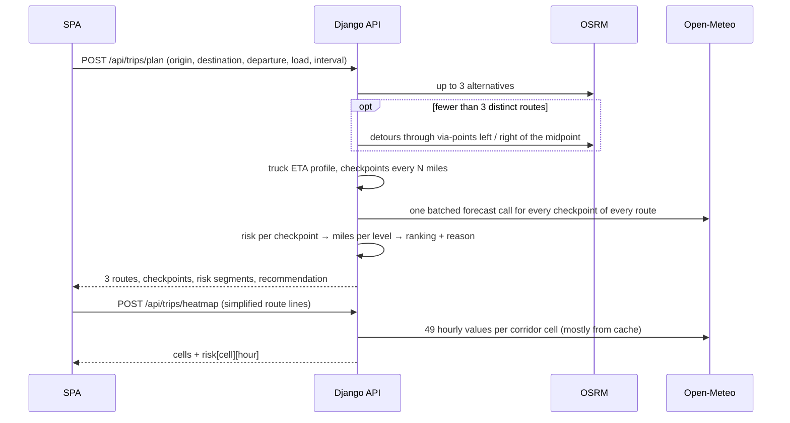

# RouteIQ — weather-aware truck routing

RouteIQ helps a truck driver pick the safest route. Enter origin, destination, departure time and
load weight. RouteIQ finds three route options, checks the forecast at every checkpoint **for the
time the truck will be there**, scores the risk with the wind / rain / snow and load rules, and
recommends a route with a one-line reason. A corridor heatmap with a 0–48 hour slider shows how
conditions move along the trip.

**Live app:** https://routeiq-fzde.onrender.com · health check: https://routeiq-fzde.onrender.com/api/health

The free Render plan sleeps when idle, so the first request after a quiet spell can take ~50 s.
Try **Dallas, TX → Chicago, IL** or **Seattle, WA → Minneapolis, MN**: long trips return three
distinct routes. Short hops (e.g. Denver → Cheyenne) often have only two real options, and the app
says so instead of inventing a third.

React 18 + TypeScript (Vite, MapLibre GL, TanStack Query) · Django 5 + DRF · OSRM · Open-Meteo ·
Photon. No API keys needed.

## Contents

- [Features](#features)
- [Quick start](#quick-start)
- [How a trip is planned](#how-a-trip-is-planned)
- [Risk rules](#risk-rules)
- [Recommendation](#recommendation)
- [Design decisions](#design-decisions)
- [Architecture](#architecture)
- [API](#api)
- [Configuration](#configuration)
- [Deployment](#deployment)
- [Tests and CI](#tests-and-ci)
- [Known limits](#known-limits)

## Features

- **3 route options**: router alternatives, plus via-point detours when the router returns
  fewer. Near-duplicates are removed.
- **Checkpoints every 10 / 25 / 50 mi**, each with an ETA from the route's own segment timings,
  capped at a truck speed (65 mph by default).
- **Forecast at ETA**: wind is interpolated between hours; rain and snow use the hour bucket the
  truck is driving through.
- **Risk engine**: the brief's thresholds plus the load rules, with a plain reason for every
  level above Low ("Load 42,000 lb raises wind risk High → Severe"). The recommendation always
  says what the load did — how many checkpoints it raised, or why it changed nothing (e.g. the
  strongest wind was under 35 mph).
- **Recommendation**: fewest No Travel → Severe → High miles → least weather exposure
  (risk-miles) → shortest time, with the deciding criterion shown.
- **Every route, not just the winner**: a comparison table shows each route's miles per risk
  level, weather exposure, drive time, number of forecast checkpoints and worst condition.
- **One selected route, everywhere**: only the route on the map can have its card open with the
  checkpoint weather table. Picking a route anywhere — its card, its row in the comparison table,
  or its line on the map — selects it, opens its card, closes the others and scrolls to it.
  Clicking the open card closes it (the route stays on the map); clicking again reopens it.
  Clicking a checkpoint on the map, or ⏮ / ⏭ / ▶, reopens the card and scrolls to that row.
- **Map**: the selected route is coloured by risk; the recommended route stays solid green while
  you inspect another one; other routes are dashed and clickable.
- **Corridor heatmap** with a 0–48 h slider (15-minute steps) and a truck marker showing where the
  selected route puts the truck at that time. Ticks under the slider mark each checkpoint's ETA,
  coloured by its risk; "Trip only" shortens the slider to end at arrival.
- **Resizable sidebar**: drag its right edge (or focus it and use ← / →) to widen the route
  tables or give the map more room; double-click resets it, and the width is remembered.
- **Checkpoint stepping and playback**: ⏮ / ⏭ jump to the previous or next checkpoint and open its
  weather; ▶ drives the selected route checkpoint by checkpoint in ETA order and stops when the
  truck arrives.

## Quick start

Requirements: Python 3.12 with [uv](https://docs.astral.sh/uv/), Node 20+ with
[pnpm](https://pnpm.io/).

```bash
make setup        # creates .env from .env.example, installs backend + frontend deps
make dev-api      # terminal 1 — Django on 127.0.0.1:8000
make dev-web      # terminal 2 — Vite on http://localhost:5173 (proxies /api)
```

Without make:

```bash
cp .env.example .env
cd backend && uv sync && uv run python manage.py runserver 127.0.0.1:8000
cd frontend && pnpm install && pnpm dev
```

Production-like run (one container serving API + SPA, with Redis):

```bash
cp .env.example .env         # set SECRET_KEY
docker compose up --build    # http://localhost:8080
```

## How a trip is planned



1. **Routes.** OSRM returns up to 3 alternatives. While fewer than 3 distinct routes exist, the
   API routes through a via-point offset to each side of the midpoint (±15%, then ±30% of the
   straight-line distance). A route that overlaps an accepted one by 80% or more, or is longer
   than 1.75 × the fastest, is dropped. If geography allows fewer than 3, the response says so.
2. **ETA.** Each road segment takes `max(router time, distance / truck max speed)`, so a car
   profile never makes a truck faster than the cap.
3. **Checkpoints** sit at mile 0, N, 2N, … plus the destination (N = 10, 25 or 50).
4. **Weather at ETA.** One batched call covers every checkpoint of every route. Precipitation
   uses the hour bucket the truck is driving through; wind is interpolated between hours.
5. **Risk and ranking**: see the next two sections.
6. **Heatmap.** The SPA asks for it right after the plan, so routes show first. The API builds a
   band of grid cells around the routes, fetches 49 hourly values per cell and scores each with
   the same risk engine. The slider never calls the server: every hour is stored on each map
   feature, and moving the slider only swaps the layer's colour expression.

## Risk rules

| Condition | Low | Moderate | High | Severe | No Travel |
|---|---|---|---|---|---|
| Wind (mph) | < 25 | 25 – < 35 | 35 – < 45 | 45 – < 55 | ≥ 55 |
| Rain (in/hr) | < 0.10 | 0.10 – < 0.25 | 0.25 – < 0.50 | 0.50 – 1.00 | > 1.00 |
| Snow (in/hr) | < 0.5 | 0.5 – < 1.0 | 1.0 – < 2.0 | 2.0 – 3.0 | > 3.0 |

The brief's ranges share their edges (e.g. rain 0.10–0.25 and 0.25–0.50), so each range is read
as including its lower bound; the No Travel rows keep the brief's strict `>`.

Load rules only raise the wind level:

| Wind | Load | Result |
|---|---|---|
| ≥ 55 mph | any | No Travel |
| 45–54 mph | > 30,000 lb | No Travel |
| 35–44 mph | > 40,000 lb | Severe |

A checkpoint's level is the worst of wind (after load rules), rain and snow. Every boundary is
covered by a test in `backend/tests/domain/test_risk.py`.

Inputs:
- Wind = sustained 10 m wind. Gusts are shown but not scored.
- Rain = Open-Meteo `rain + showers`; snow = `snowfall`; both are inches over the hour.

## Recommendation

Routes are sorted by this tuple; smaller wins. Values are rounded so float noise never decides.

1. No Travel miles
2. Severe miles
3. High miles
4. Weather exposure in risk-miles: each mile × its level (Moderate 1, High 2, Severe 3,
   No Travel 4)
5. Drive time

The reason names the first step where the winner beats the runner-up, for example
*"Fewest Severe miles: 0.0 mi vs 37.5 mi on Route B."* A warning is shown when even the winner
crosses No Travel or Severe conditions.

Three choices go beyond the brief's wording, on purpose:
- **No Travel miles rank first.** The brief's list starts at Severe, but a No Travel stretch is
  strictly worse.
- **Step 4 compares risk-miles, not a per-mile average.** A per-mile average lets a longer
  detour dilute the same bad miles with extra Low miles and win while being hours slower. Steps 2
  and 3 already compare totals, so step 4 does too. Average risk is still shown on each route.
- **Each checkpoint covers the road from halfway back to the previous checkpoint to halfway to
  the next.** The same storm then gives nearly the same miles at 10, 25 or 50 mi spacing. Giving
  each stretch the worse of its two checkpoints would let one bad sample count twice: 100 Severe
  miles at 50 mi spacing, 20 at 10 mi, for the same storm.

## Design decisions

| Decision | Why | Trade-off |
|---|---|---|
| Free, keyless providers behind interfaces | Anyone can run it without signing up; a paid or truck-aware provider is one new adapter | OSRM's car profile ignores truck limits; the free Open-Meteo quota counts every location |
| Detour via-points to reach 3 routes | Public OSRM often returns 1–2 alternatives on long trips | Detours are longer; they are ranked like any route |
| Truck speed cap on router durations | A car profile is faster than a loaded truck | An approximation, configurable with `TRUCK_MAX_SPEED_MPH` |
| Forecast at each checkpoint's ETA | Storms move; departure-time weather would be wrong hours later | Forecast skill drops after ~48 h |
| Lexicographic ranking | Follows the brief's priority order and is fully explainable | A route can win while slower if it has fewer bad miles; the reason says so |
| Heatmap as a grid of cells, all 49 hours sent once | A density heatmap adds up overlapping points, so two Moderate cells would look Severe; preloaded hours make the slider a paint change with no request | Cells look blocky at high zoom, which matches the forecast resolution |
| Stateless heatmap endpoint | Works across gunicorn workers with no shared session | The client re-sends simplified geometry (a few KB) |
| MapLibre GL (WebGL) over Leaflet | Heatmap cells, lines and thousands of points stay smooth | Larger bundle |
| One container: gunicorn + WhiteNoise serving the SPA | Same origin, so no CORS in production and one deploy | API and UI scale together |

## Architecture

```
frontend (React SPA) ──/api──▶ api (DRF views: validate → service → present)
                                   │
                                services: RouteOptions · TripPlanner · CorridorHeatmap
                                   │
                    domain (pure)  │  ports (Protocols)  ◀── adapters: OSRM · Open-Meteo · Photon
                    risk, eta,     │                         + CachedWeatherProvider (Django cache)
                    checkpoints, scoring, recommendation, corridor
```

Dependency rule: `api → services → domain + ports ← adapters`. The domain is plain Python with no
Django or HTTP, and only `backend/routeiq/container.py` knows the concrete adapters.

```
backend/
├── config/            typed env (env.py is the only code that reads the environment), settings
└── routeiq/
    ├── domain/        risk rules, ETA, checkpoints, forecast lookup, scoring, ranking, corridor
    ├── ports.py       RoutingProvider, WeatherProvider, Geocoder interfaces + error types
    ├── adapters/      OSRM, Open-Meteo (+ cache decorator), Photon, shared HTTP client
    ├── services/      route options, trip planner, corridor heatmap
    └── api/           serializers (input), presenters (output), views, error mapping
frontend/src/
├── api/               fetch client, typed request/response shapes
├── domain/            risk colours, formatters, playback steps, truck position
└── features/          trip-form · routes · map (layers, GeoJSON) · heatmap (control, usePlayback)
```

What keeps the map smooth:
- GeoJSON is built once per API response, never per slider step.
- Heatmap cells carry every hour as properties; the slider only changes the fill colour.
- Checkpoints are one GL circle layer, not DOM markers.
- Sidebar components are memoized, so dragging the slider re-renders only the map and control.

## API

| Method | Path | Purpose | Rate limit (per IP) |
|---|---|---|---|
| GET | `/api/health` | liveness | 120/min |
| GET | `/api/geocode?q=&limit=` | place autocomplete (`q` 2–120 chars, `limit` ≤ 8) | 60/min |
| POST | `/api/trips/plan` | routes, checkpoints, risk, recommendation | 20/min |
| POST | `/api/trips/heatmap` | corridor cells × 49 hourly risk scores | 20/min |

Plan a trip:

```bash
curl -X POST https://routeiq-fzde.onrender.com/api/trips/plan \
  -H 'Content-Type: application/json' \
  -d '{
    "origin":      {"lat": 32.7767, "lon": -96.7970, "label": "Dallas, TX"},
    "destination": {"lat": 41.8781, "lon": -87.6298, "label": "Chicago, IL"},
    "departure_time": "2026-10-24T14:00:00Z",
    "load_weight_lb": 42000,
    "checkpoint_interval_mi": 25
  }'
```

- `departure_time`: ISO 8601 with an offset, from 1 hour ago to 7 days ahead.
- `load_weight_lb`: 1–80,000. `checkpoint_interval_mi`: 10, 25 or 50.
- Origin and destination must be at least 1 mile apart.

Response, trimmed to one route, checkpoint and segment (example values):

```jsonc
{
  "routes": [{
    "id": "a", "label": "Route A", "summary": "I 35, I 44, I 55",
    "distance_mi": 966.5, "duration_s": 61560,
    "departure": "2026-10-24T14:00:00Z", "arrival": "2026-10-25T07:06:00Z",
    "risk": {
      "miles_by_level": {"low": 941.5, "moderate": 25.0, "high": 0, "severe": 0, "no_travel": 0},
      "exposure": 25.0, "average": 0.03, "max_level": "moderate"
    },
    "checkpoints": [{
      "index": 1, "mile": 25, "coordinate": [-96.9, 33.1], "eta": "2026-10-24T14:27:00Z",
      "weather": {"wind_mph": 27.4, "gust_mph": 38.0, "rain_in_hr": 0.0, "snow_in_hr": 0.0},
      "risk": {"level": "moderate", "score": 1, "wind": "moderate", "rain": "low", "snow": "low",
               "reasons": ["Wind 27.4 mph → Moderate"]}
    }],
    "segments": [{"start_mile": 12.5, "end_mile": 37.5, "level": "moderate", "coordinates": [[-96.9, 33.0]]}]
  }],
  "recommendation": {"route_id": "a", "ranking": ["a", "c", "b"],
                     "reason": "Least weather exposure: 25.0 risk-mi vs 50.0 risk-mi on Route C.",
                     "warnings": []},
  "notes": []
}
```

The heatmap takes `{lines: [[[lon, lat], …]] (1–3 lines, ≤ 5000 points each), departure_time,
load_weight_lb}` and returns `{start_time, hours: 49, cell_size_deg, cells: [[lon, lat]],
risk: [[score × 49]]}`. Full types are in [`frontend/src/api/types.ts`](frontend/src/api/types.ts).

Errors always have one shape, `{"error": {"code", "message", "details"?}}`:

| Status | Code | When |
|---|---|---|
| 400 | `invalid_request` | a field failed validation (`details` lists them) |
| 422 | `no_route` | no drivable route between the points |
| 429 | `throttled` | this API's per-IP rate limit |
| 502 | `provider_unavailable` | a provider is down or returned bad data, including a forecast with missing values (never read as Low) |
| 503 | `provider_rate_limited` | a provider's quota is used up; the message passes on the provider's reason |

Gateway errors from providers (502/503/504) are retried twice with backoff. Provider rate limits
are not retried, because per-minute and per-hour quotas don't clear in seconds.

## Configuration

There is one `.env` at the repo root, documented line by line in [`.env.example`](.env.example).
The backend reads it through a typed `pydantic-settings` class
([`backend/config/env.py`](backend/config/env.py)) and fails at startup on invalid values. Vite
reads the same file but only exposes `VITE_*` keys to the browser.

| Variable | Default | Notes |
|---|---|---|
| `APP_ENV` | `development` | `production` refuses to start with a missing `SECRET_KEY`, `DEBUG=true` or `ALLOWED_HOSTS=*` |
| `SECRET_KEY` | — | required in production |
| `ALLOWED_HOSTS`, `CSRF_TRUSTED_ORIGINS` | `localhost,127.0.0.1`, empty | comma-separated |
| `CACHE_URL` | empty (in-process) | set a Redis URL to share the cache across workers |
| `OPEN_METEO_API_KEY` | empty | optional; removes the free-tier quota (also set `OPEN_METEO_BASE_URL` to the customer API) |
| `TRUCK_MAX_SPEED_MPH` | `65` | 30–85 |
| `HTTP_USER_AGENT` | `RouteIQ/1.0 …` | public OSM services ask for an identifying agent with a contact URL |

## Deployment

The `Dockerfile` is multi-stage: pnpm builds the SPA, then a slim Python image runs gunicorn as a
non-root user, and WhiteNoise serves the SPA from the same origin (hashed assets cached as
immutable, responses gzipped). The image has a `HEALTHCHECK` on `/api/health`.

- **Render:** [`render.yaml`](render.yaml) is a blueprint for the live service. It generates
  `SECRET_KEY` and sets the host names; health checks use `/api/health`.
- **Any Docker host:** build the image and set `APP_ENV=production`, `SECRET_KEY`,
  `ALLOWED_HOSTS` and `CSRF_TRUSTED_ORIGINS`. Set `CACHE_URL` to Redis when running more than
  one instance.
- In production the app redirects HTTP to HTTPS behind a TLS-terminating proxy (except the
  health check), sends HSTS and `nosniff` headers, and logs to stdout.

## Tests and CI

```bash
make test    # 122 backend tests (pytest) + 19 frontend tests (vitest)
make lint    # ruff + TypeScript strict typecheck
```

- Domain: every threshold boundary, load rules, ETA and speed cap, forecast lookup, scoring
  (including storm miles staying stable across intervals), ranking and tie-breaks.
- Adapters: parsing against **recorded real responses** from OSRM, Open-Meteo and Photon
  (`backend/tests/adapters/fixtures`), plus request-parameter checks.
- Services and API: fake ports (our own interfaces), validation and error mapping.
- Frontend: playback stepping, slider range, truck position, GeoJSON builders.

CI ([`.github/workflows/ci.yml`](.github/workflows/ci.yml)) runs lint, tests, the frontend build
and the Docker build on pushes to `main` and `develop` and on every pull request.

## Known limits

- OSRM's public car profile ignores truck restrictions (weight, height, hazmat). Durations are
  capped at a truck speed, but routing is not truck-legal routing.
- Forecasts come from public models; skill drops after ~48 h. Departure is limited to the next
  7 days.
- Hours-of-service breaks are not modelled; ETAs assume continuous driving.
- Weather is looked up on a shared ~12 mi grid (coarser only for very long trips), so a
  checkpoint reads the forecast of its grid cell, at its own ETA.
- The free Open-Meteo tier counts every location (~600/minute, 5,000/hour). A trip uses at most
  ~400 lookups and repeats come from the cache, but many brand-new trips in one hour can still hit
  the hourly limit; the app then shows the provider's reason. `OPEN_METEO_API_KEY` removes it.
