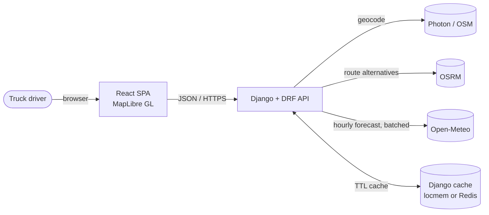
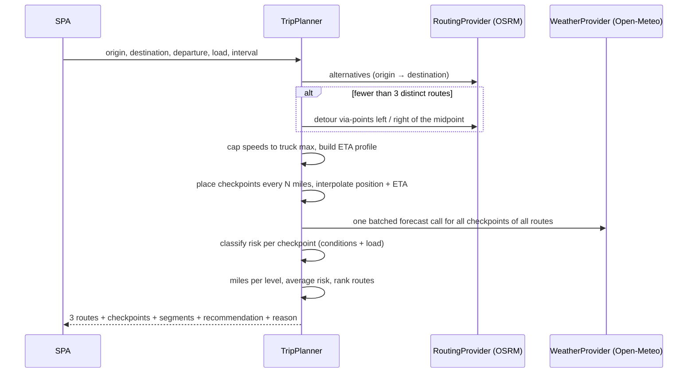
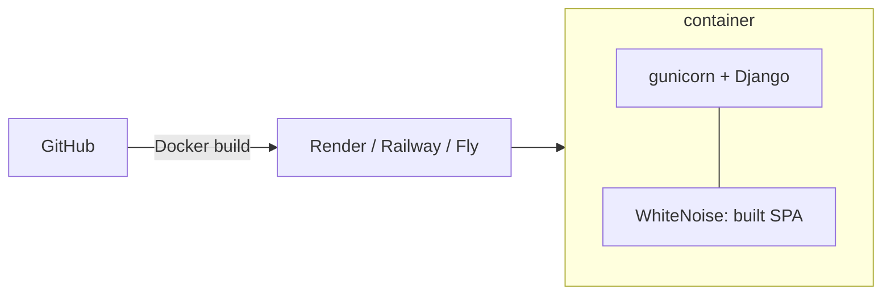

# RouteIQ — High-Level Design

Weather-aware truck routing. A driver enters origin, destination, departure time and load
weight. RouteIQ returns three route options, samples the forecast at each checkpoint for the
time the truck will actually be there, scores weather risk with the load rules, and recommends
the safest route. A corridor heatmap shows how risk moves over the next 0–48 hours.

## 1. Goals and non-goals

| Goals | Non-goals |
|---|---|
| 3 route options per trip | Building a routing engine |
| Checkpoints every 10 / 25 / 50 mi, weather at the truck's ETA | Hours-of-service / rest-stop planning |
| Risk from the brief's wind / rain / snow + load rules | Accounts, saved trips, persistence |
| Deterministic, explainable recommendation | Live traffic |
| Map with routes, checkpoints, ETAs, summaries | Bridge-height / hazmat restrictions |
| Corridor heatmap with a smooth 0–48 h slider | |

## 2. System context

All three providers are free and keyless. Each sits behind a port, so a paid provider
(OpenRouteService HGV, Mapbox, Tomorrow.io) is a new adapter, not a rewrite.

## 3. Containers

| Container | Tech | Responsibility |
|---|---|---|
| SPA | React 18, TypeScript, Vite, MapLibre GL, TanStack Query | Trip form, route cards, map, heatmap slider |
| API | Django 5, DRF, httpx, pydantic-settings | Validation, orchestration, risk engine, provider adapters |
| Cache | Django cache (locmem in dev, Redis when `CACHE_URL` is set) | Forecast and geocode responses |

In production one container runs gunicorn; WhiteNoise serves the built SPA from the same
origin, so there is no CORS and one deploy.

## 4. Main flows

### 4.1 Plan a trip — `POST /api/trips/plan`

### 4.2 Corridor heatmap — `POST /api/trips/heatmap`

The SPA calls this right after the plan returns, so routes show before the heatmap is ready.

1. The SPA sends the simplified route lines, departure time and load.
2. The API samples the lines, offsets points to both sides to form a band, snaps them to a
   0.2° grid and removes duplicates (capped at ~400 cells).
3. One batched Open-Meteo call fetches 49 hourly values per cell.
4. Each cell/hour is classified with the same risk engine as checkpoints.
5. The response is compact: `cells[]` and `risk[cell][hour]` as small integers.

The slider never calls the server. Every hour's risk is stored on each GeoJSON feature
(`h0..h48`); moving the slider only swaps the heatmap layer's paint expression, which the
GPU redraws in one frame.

## 5. Key decisions

| Decision | Why | Trade-off |
|---|---|---|
| OSRM + detour via-points to guarantee 3 routes | Public OSRM often returns 1–2 alternatives on long trips | Detours can be longer; they are ranked like any route |
| Truck speed cap (default 65 mph) on car-profile durations | OSRM's car profile is faster than a loaded truck | Approximation, configurable via env |
| Forecast at the checkpoint ETA, not at departure | The brief asks for it; storms move | Forecast skill drops after ~48 h |
| Segment risk = worse of its two checkpoints | Conservative: never hide a bad stretch | Slight over-count of high-risk miles |
| No Travel miles rank before Severe miles | A No Travel stretch is worse than Severe; the brief's order starts at Severe | Documented extension of the rule list |
| Lexicographic ranking with rounding tolerance | Matches the brief's explicit priority order and is explainable | A route may win with a much longer ETA — the reason text says why |
| Stateless heatmap endpoint | Works across gunicorn workers without shared session storage | Client re-sends simplified geometry (a few KB) |
| MapLibre GL (WebGL) over Leaflet | Heatmap, lines and 1000s of points stay at 60 fps | Larger bundle than Leaflet |

## 6. Quality attributes

- **Correctness** — the risk engine, sampling and ranking are pure functions with boundary
  tests for every threshold in the brief.
- **Performance** — one batched weather call per request; forecast responses are cached by
  rounded coordinate and day; map layers are GPU-rendered; slider is client-only.
- **Resilience** — provider timeouts and retries; provider failures map to `502` with a clear
  message, never a silent default. A checkpoint with no forecast is reported as unknown and
  never counted as Low.
- **Security** — all input validated at the API boundary; secrets come only from the
  environment; `DEBUG` off and `SECRET_KEY` required in production.

## 7. Deployment

Multi-stage Dockerfile: Node builds the SPA, Python image runs Django and serves `dist/`.
